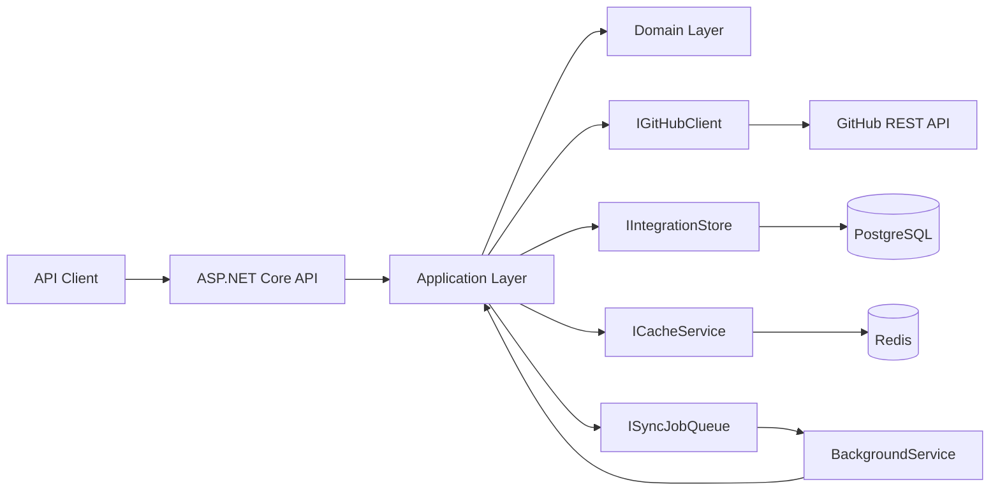
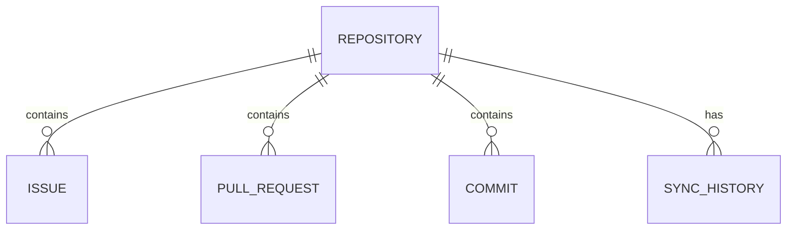
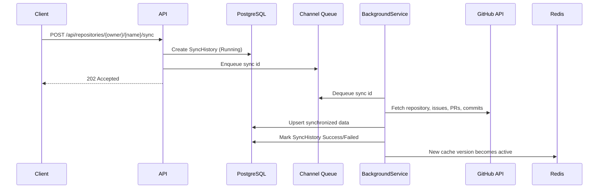

# GitHub Integration Service


A production-style **.NET 10 integration microservice** that consumes the GitHub REST API, synchronizes repository data into PostgreSQL, caches read models in Redis, and processes synchronization jobs in the background.

The project is built as a portfolio project for a .NET backend developer and focuses on patterns commonly used in real integration services: typed HTTP clients, resilience, persistence, caching, background processing, observability, containerization, and automated testing.

## Highlights

- ASP.NET Core Web API on **.NET 10 / C# 14**
- Clean Architecture with clear dependency boundaries
- GitHub REST API integration using a typed `HttpClient`
- Personal Access Token (PAT) authentication
- Resilience pipeline with `Microsoft.Extensions.Http.Resilience` / Polly
- Entity Framework Core with PostgreSQL
- Redis distributed cache
- Background synchronization using `BackgroundService` and `Channel<T>`
- GitHub API rate-limit handling and unified error mapping
- Swagger / OpenAPI
- Liveness and readiness health checks
- Structured logging with Serilog
- Docker and Docker Compose
- Unit tests and PostgreSQL integration tests with Testcontainers
- GitHub Actions CI

## Architecture



Dependency direction:

```text
GitHubIntegration.Api
        |
        v
GitHubIntegration.Application ---> GitHubIntegration.Domain
        ^
        |
GitHubIntegration.Infrastructure
```

`Application` depends on abstractions rather than infrastructure implementations. GitHub, PostgreSQL, Redis, and the synchronization queue are wired through dependency injection in the outer layers.

## Tech Stack

| Area | Technology |
|---|---|
| Runtime | .NET 10, C# 14 |
| API | ASP.NET Core Web API |
| External integration | GitHub REST API, typed `HttpClient` |
| Resilience | Microsoft.Extensions.Http.Resilience / Polly |
| Database | PostgreSQL 17 |
| ORM | Entity Framework Core 10 |
| Cache | Redis 8 |
| Background processing | `BackgroundService`, `Channel<T>` |
| Logging | Serilog |
| API documentation | Swagger / OpenAPI |
| Testing | xUnit v3, Testcontainers |
| Containerization | Docker, Docker Compose |
| CI | GitHub Actions |

## What the Service Synchronizes

For every tracked GitHub repository, the service stores:

- repository metadata;
- issues;
- pull requests;
- commits;
- synchronization history.

GitHub's Issues API also returns pull requests. The service filters those records from the issue stream and synchronizes pull requests separately, preventing duplicate local data.

## Data Model



Important uniqueness constraints:

- Repository: `GitHubId`, `FullName`
- Issue: `(RepositoryId, Number)`
- Pull request: `(RepositoryId, Number)`
- Commit: `(RepositoryId, Sha)`

These constraints make synchronization idempotent and prevent duplicate records during repeated sync operations.

## Quick Start with Docker

### Prerequisites

- Docker Desktop or Docker Engine with Docker Compose
- A GitHub Personal Access Token

### 1. Clone the repository

```bash
git clone <repository-url>
cd github-integration-service
```

### 2. Create the environment file

Linux/macOS:

```bash
cp .env.example .env
```

Windows PowerShell:

```powershell
Copy-Item .env.example .env
```

Set your token in `.env`:

```env
GITHUB_TOKEN=github_pat_your_real_token
```

> Never commit a real GitHub token. `.env` is excluded by `.gitignore`.

### 3. Start the stack

```bash
docker compose up --build
```

Services:

| Service | URL |
|---|---|
| Swagger UI | `http://localhost:8080/swagger` |
| API | `http://localhost:8080` |
| Health | `http://localhost:8080/health` |
| Liveness | `http://localhost:8080/health/live` |
| Readiness | `http://localhost:8080/health/ready` |

## First API Call

Track the `dotnet/runtime` repository:

```bash
curl -X POST http://localhost:8080/api/repositories \
  -H "Content-Type: application/json" \
  -d '{"owner":"dotnet","name":"runtime"}'
```

The response contains an `initialSyncId`. Check its status:

```bash
curl http://localhost:8080/api/sync/<SYNC_ID>
```

Read synchronized data:

```bash
curl "http://localhost:8080/api/repositories/dotnet/runtime/issues?state=open&page=1&pageSize=20"

curl "http://localhost:8080/api/repositories/dotnet/runtime/pull-requests?state=open&page=1&pageSize=20"

curl "http://localhost:8080/api/repositories/dotnet/runtime/commits?branch=main&page=1&pageSize=20"
```

A ready-to-use HTTP request collection is also available at `src/GitHubIntegration.Api/GitHubIntegration.Api.http` for Visual Studio and JetBrains Rider.

## REST API

| Method | Endpoint | Description |
|---|---|---|
| `POST` | `/api/repositories` | Track a repository and queue the initial synchronization |
| `GET` | `/api/repositories` | List tracked repositories |
| `GET` | `/api/repositories/{owner}/{name}` | Get repository metadata |
| `DELETE` | `/api/repositories/{owner}/{name}` | Delete locally stored repository data |
| `GET` | `/api/repositories/{owner}/{name}/issues` | Get issues with pagination and filters |
| `GET` | `/api/repositories/{owner}/{name}/pull-requests` | Get pull requests with pagination and filters |
| `GET` | `/api/repositories/{owner}/{name}/commits` | Get commits with pagination and branch filter |
| `POST` | `/api/repositories/{owner}/{name}/sync` | Queue a manual synchronization |
| `GET` | `/api/sync/{syncId}` | Get synchronization status |

Issues and pull requests support:

```text
?page=1&pageSize=20&state=open&author=octocat
```

Commits support:

```text
?page=1&pageSize=20&branch=main
```

`pageSize` is capped at `100`.

## Synchronization Flow



By default, one synchronization fetches at most two pages of 100 records per resource type. This protects the demo service from accidentally downloading a very large repository history. The limits are configurable.

## Caching Strategy

PostgreSQL is the source of truth. Redis is an optional acceleration layer for reads.

- Default read-cache TTL: 5 minutes
- Cache keys include the repository's latest synchronization timestamp
- A successful synchronization automatically moves reads to a new cache version
- If Redis is temporarily unavailable, reads continue against PostgreSQL

## Resilience and Rate Limits

The GitHub client uses the standard .NET HTTP resilience handler. External API failures are mapped to a single application-level `ExternalServiceException`.

When GitHub reports an exhausted API rate limit, the API returns `429 Too Many Requests` and includes the reset time in Problem Details when GitHub provides it.

## Configuration

Docker Compose reads the PAT from `.env` and passes the remaining settings as environment variables.

| Setting | Purpose | Default |
|---|---|---|
| `GITHUB_TOKEN` | GitHub PAT used by Docker Compose | required |
| `GitHub__ApiVersion` | GitHub REST API version | `2026-03-10` |
| `GitHub__PageSize` | GitHub page size | `100` |
| `GitHub__MaxPages` | Maximum pages per resource type per sync | `2` |
| `ConnectionStrings__Database` | PostgreSQL connection string | configured by Compose |
| `ConnectionStrings__Redis` | Redis connection string | configured by Compose |

## Run the API without Docker

Requirements:

- .NET SDK 10
- PostgreSQL
- Redis

PowerShell:

```powershell
$env:GitHub__Token="github_pat_your_token"
dotnet restore
dotnet run --project src/GitHubIntegration.Api
```

Bash:

```bash
export GitHub__Token="github_pat_your_token"
dotnet restore
dotnet run --project src/GitHubIntegration.Api
```

The default local development connection strings are defined in `appsettings.json`.

## Testing

Run unit tests:

```bash
dotnet test tests/GitHubIntegration.UnitTests
```

Run integration tests:

```bash
dotnet test tests/GitHubIntegration.IntegrationTests
```

Integration tests use Testcontainers and therefore require Docker.

Run the full solution test suite:

```bash
dotnet test GitHubIntegration.sln
```

GitHub Actions runs restore, Release build, unit tests, integration tests, and a Docker image build on pushes and pull requests targeting `main`.

## Project Structure

```text
.
├── .github/
│   ├── ISSUE_TEMPLATE/
│   ├── workflows/
│   └── pull_request_template.md
├── src/
│   ├── GitHubIntegration.Api/
│   ├── GitHubIntegration.Application/
│   ├── GitHubIntegration.Domain/
│   └── GitHubIntegration.Infrastructure/
├── tests/
│   ├── GitHubIntegration.UnitTests/
│   └── GitHubIntegration.IntegrationTests/
├── .env.example
├── .gitignore
├── CONTRIBUTING.md
├── Dockerfile
├── GitHubIntegration.sln
├── LICENSE
├── README.md
├── SECURITY.md
└── docker-compose.yml
```

## Design Decisions and Trade-offs

This repository intentionally keeps the MVP focused.

### In-memory synchronization queue

Synchronization jobs are queued through `Channel<T>`. This keeps the project dependency-light and demonstrates asynchronous background processing.

Trade-off: queued work is not durable across process restarts. A production deployment would typically use RabbitMQ, Kafka, Azure Service Bus, or another durable broker.

### `EnsureCreated` instead of migrations

The MVP creates the schema automatically on startup for a frictionless local demo.

Trade-off: production systems should use versioned EF Core migrations and a controlled migration strategy.

### PostgreSQL as source of truth

Redis is never authoritative. Losing Redis does not lose synchronized GitHub data.

### Limited synchronization depth

The default page limit keeps API consumption predictable and avoids unexpectedly exhausting GitHub API quotas when tracking very large repositories.

## Roadmap

- [ ] GitHub OAuth for per-user authorization
- [ ] GitHub webhooks for push, issue, and pull-request events
- [ ] Durable message broker for synchronization jobs
- [ ] Scheduled synchronization with Quartz or Hangfire
- [ ] EF Core migrations
- [ ] OpenTelemetry traces and metrics
- [ ] Prometheus / Grafana observability stack
- [ ] Authentication and authorization for this service's own API

## Security

Do not commit PATs, passwords, or other credentials. See [SECURITY.md](SECURITY.md) for vulnerability reporting guidance.

For a public GitHub repository, enabling GitHub secret scanning and push protection is strongly recommended.

## Contributing

Contributions are welcome. See [CONTRIBUTING.md](CONTRIBUTING.md) for the development workflow and pull request guidelines.

## License

Distributed under the MIT License. See [LICENSE](LICENSE) for details.
